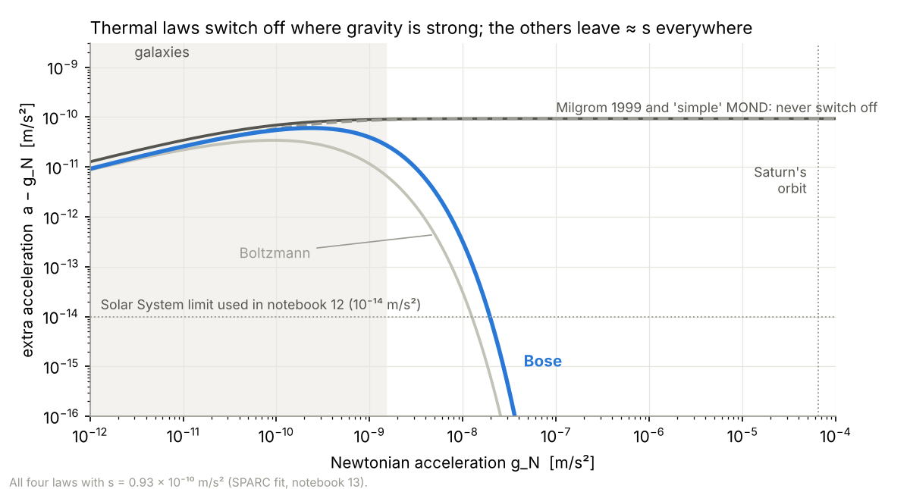
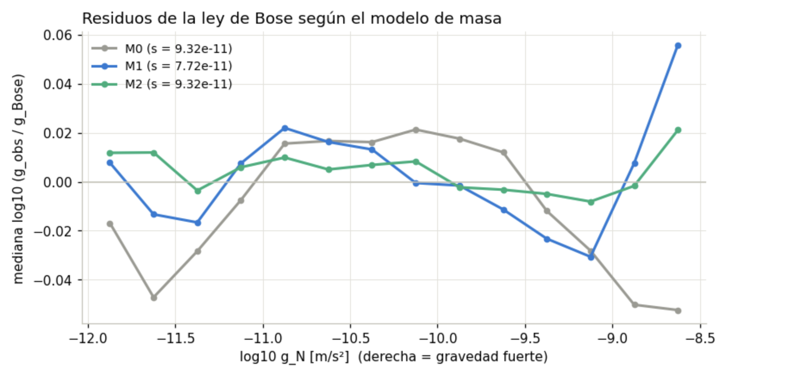
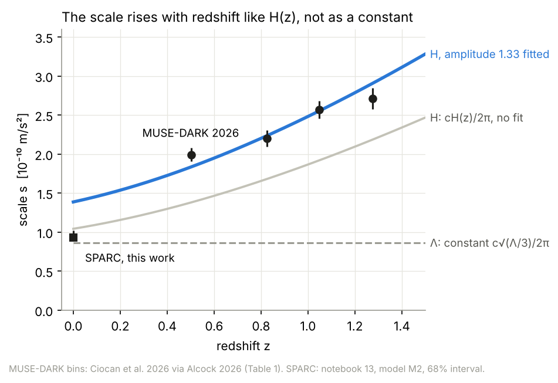

# ER-Particles

**Can entanglement mimic dark matter? A speculative idea, tested step by step against real galaxies.**

This repository follows one idea from its first formulation to the version that survives contact with data, in 13 notebooks that run in Google Colab. It started from ER=EPR (entangled particles joined by Einstein–Rosen bridges) and ended with a thermal law for galaxy rotation whose scale is set by the temperature of the cosmic horizon.

It is a companion to the educational course [quantum-vacuum-journey](https://github.com/jordicusidoroura-stack/quantum-vacuum-journey).

## The result in one paragraph

Rotating galaxies are well described by a law of Bose–Einstein form whose only scale is set by the temperature of the cosmic horizon, with no free acceleration parameter. On 149 SPARC galaxies the fitted scale is $s \approx 0.93 \times 10^{-10}\ \mathrm{m\,s^{-2}}$. A version with the scale fixed in advance predicts held-out galaxies as well as a fitted one. The correction vanishes in the Solar System, and published intermediate-redshift data (MUSE-DARK, 2026) reject a constant scale and are compatible with $s \propto H(z)$.

**What is not new:** the functional form is the empirical radial acceleration relation (McGaugh, Lelli & Schombert 2016), the coincidence $a_0 \approx cH_0/2\pi$ is Milgrom's, and the evolution with $H(z)$ has been proposed and measured by others. What this project adds is a thermal reading that links them, a systematic pre-registered comparison of laws and scales, and the whole path, failures included, in reproducible form.

## The idea in four equations

**1. Horizons have a temperature.** An observer with acceleration $a$ sees the vacuum as a thermal bath (Unruh). In a universe with a cosmological constant, the temperature combines the observer's acceleration with the de Sitter horizon (Deser & Levin 1997):

$$
2\pi\,\frac{c\,k_B T}{\hbar} = \sqrt{a^2 + a_\Lambda^2}, \qquad a_\Lambda = c\sqrt{\Lambda/3}.
$$

In ER=EPR language, that temperature *is* entanglement across the horizon.

**2. Galaxies follow a Bose–Einstein occupation.** With $g_N$ the Newtonian acceleration of the visible matter and $x = \sqrt{g_N/s}$:

$$
a = \frac{g_N}{1 - e^{-x}} = g_N\,\bigl[1 + n_{BE}(x)\bigr], \qquad n_{BE}(x) = \frac{1}{e^{x} - 1}.
$$

When gravity is weak ($x \ll 1$) this gives $a \to \sqrt{s\,g_N}$: flat rotation curves and the baryonic Tully–Fisher relation $v^4 = G M s$. When gravity is strong ($x \gg 1$) the correction dies as $e^{-x}$, like a cold bath.

**3. The scale is the temperature of the cosmic apparent horizon** (Cai & Kim 2005):

$$
k_B T_H = \frac{\hbar H}{2\pi} \quad\Longrightarrow\quad s(z) = \frac{c\,H(z)}{2\pi}, \qquad s(0) = 1.04 \times 10^{-10}\ \mathrm{m\,s^{-2}}.
$$

**4. A falsifiable prediction.** With $E(z) = H(z)/H_0 = \sqrt{\Omega_m (1+z)^3 + \Omega_\Lambda}$, the scale and the Tully–Fisher zero point evolve as

$$
\frac{s(z)}{s(0)} = E(z), \qquad \Delta \log v_f\big|_{M} = \tfrac14 \log E(z), \qquad \Delta \log M\big|_{v_f} = -\log E(z).
$$

At $z = 2$ that is a scale three times larger and galaxies 0.48 dex lighter at fixed rotation speed. A constant scale, $s = c\sqrt{\Lambda/3}/2\pi$, predicts no change.

## The evidence in three figures

**Why a thermal law.** All four candidate laws behave alike in galaxies, but only the thermal ones switch off where gravity is strong. Laws that never switch off add about $10^{-10}\ \mathrm{m\,s^{-2}}$ at Saturn's orbit, far above what planetary ephemerides allow; the Bose law adds about $10^{-382}\ \mathrm{m\,s^{-2}}$. In SPARC the Bose form also beats the classical (Boltzmann) occupation by $\Delta\mathrm{BIC} \approx 560$.



**The mass model matters.** Giving each galaxy its own bulge mass, distance and inclination (model M2) flattens the residuals of the Bose law to within ±0.012 dex. It also shows that local galaxies alone cannot tell $c\sqrt{\Lambda/3}/2\pi$ from $cH_0/2\pi$: the difference is $\Delta\chi^2 \approx 7$ and changes sign with the stellar mass-to-light prior.



**Redshift decides.** With a free amplitude, a constant scale fails on the MUSE-DARK bins ($p = 2 \times 10^{-6}$ if the error bars are 1σ), while $s \propto H(z)$ passes ($p = 0.14$). The fitted amplitude, 1.33, is the open problem: SPARC matches $cH_0/2\pi$ without it.



| Test (notebooks 12–13) | Result |
|---|---|
| Bose vs. laws that never switch off (SPARC, mass model M2) | Bose better by $\Delta\chi^2 = 17$ |
| Held-out galaxies, $s$ fixed to a cosmological value, nothing fitted | as good as a fitted RAR ($p_{\text{worse}} = 0.68$) |
| Robustness of $s$ to the stellar mass-to-light prior (0.4–0.6) | within 10% |
| Solar System anomaly at Saturn | $\sim 10^{-382}\ \mathrm{m\,s^{-2}}$ |
| Constant scale vs. MUSE-DARK | rejected |
| $s \propto H(z)$ vs. MUSE-DARK | compatible if error bars are 1σ |

## The path, notebook by notebook

| # | Notebook | Question | Outcome |
|---|---|---|---|
| 01 | [Bridges and dark matter](notebooks/01_puentes_ER_y_materia_oscura.ipynb) | Can an ER-bridge term fit rotation curves? Error estimates against Verlinde and NFW. | Baryons alone fall short; sets up the model. |
| 02 | [Global fit and overfitting](notebooks/02_ajuste_global_y_sobreajuste.ipynb) | Do global parameters survive cross-validation? | First global fit, cross-validation and extrapolation. |
| 03 | [Non-linear model and RAR](notebooks/03_modelo_no_lineal_y_RAR.ipynb) | Does a coupling κ(g) beat the RAR? | Compared directly with the RAR. |
| 04 | [Non-local RAR](notebooks/04_RAR_no_local.ipynb) | Does a bridge range λ improve the RAR? | Apparent signal, λ ≈ 0.7 kpc. |
| 05 | [Physical or instrumental λ](notebooks/05_lambda_fisica_o_instrumental.ipynb) | Is λ a property of galaxies or of the data? | Tested against instrumental resolution models. |
| 06 | [Disc geometry, QUMOND, 3D](notebooks/06_disco_QUMOND_3D.ipynb) | Does λ survive a proper disc geometry? | Mixed. |
| 07 | [Geometry of entanglement](notebooks/07_geometria_del_entrelazamiento.ipynb) | Does entanglement build geometry in a toy model? | Yes (chains, TFD, emergent distance, first law), but no extra mass term. |
| 08 | [Independent validation](notebooks/08_validacion_independiente.ipynb) | Does λ ≈ 0.7 kpc survive a pre-registered held-out test? | **No** (p = 0.34). |
| 09 | [Dust and systematics](notebooks/09_polvo_y_sistematicos.ipynb) | Could dust explain the failure, or the signal? | No; clean subsample p = 0.15. |
| 10 | [Summing distortions](notebooks/10_suma_de_distorsiones.ipynb) | Can bridge distortions add up to a halo? | Only if concentrated where g ≲ 10⁻¹⁰ m/s². |
| 11 | [Acceleration and horizons](notebooks/11_aceleracion_y_horizontes.ipynb) | Does a horizon-temperature law (Milgrom 1999) work? | Right weak-field form, but it never switches off (ΔBIC 569). |
| 12 | [Thermal horizon laws](notebooks/12_leyes_termicas_de_horizonte.ipynb) | Does a thermal (Bose) law with a cosmological scale work, with nothing fitted? | **All 4 pre-registered criteria pass.** |
| 13 | [Scale and redshift](notebooks/13_escala_y_redshift.ipynb) | Constant scale (Λ) or one that tracks H(z)? | Local data cannot tell; redshift data favour H(z). |

Open any notebook in Colab: replace `github.com` with `colab.research.google.com/github` in its URL, or use
`https://colab.research.google.com/github/jordicusidoroura-stack/ER-Particles/blob/main/notebooks/<name>.ipynb`.

## Method

Every test from notebook 08 on follows the same rules:

1. **Pre-registration.** Hypotheses, fixed scales and pass–fail thresholds are written in the notebook before it is run on real data. Any later change is stated in the text.
2. **Held-out galaxies.** A hash of each galaxy's name splits SPARC into discovery and held-out halves. Nothing is tuned on the held-out half.
3. **Injection tests.** Synthetic galaxies with a planted law check that the pipeline recovers it, and synthetic dark-matter galaxies check that it does not invent it.
4. **Varying the assumptions.** Stellar mass-to-light priors, bulge masses, distances and inclinations are varied to see how much each result moves.

## Data

- **SPARC** rotation curves and mass models (Lelli, McGaugh & Schombert 2016, [AJ 152, 157](https://arxiv.org/abs/1606.09251)), downloaded at runtime from astroweb.case.edu/SPARC. In Colab, if the download fails, the notebook asks you to upload `Rotmod_LTG.zip`. Not redistributed here.
- **MUSE-DARK** redshift bins (Ciocan et al. 2026, [A&A 709, L16](https://arxiv.org/abs/2604.22613)), as tabulated in Alcock 2026 ([arXiv:2609.38796](https://arxiv.org/abs/2609.38796)). Four values typed into notebook 13, with their source.

Without network access every notebook falls back to synthetic galaxies and says so in its output. Those runs check the code only; they have no physical meaning.

## Running the tests

```bash
pip install -r requirements.txt
pytest -q tests
```

The tests run every notebook offline on synthetic data (about 3 minutes in total) and check three results:

- notebook 12 recovers a Bose law injected at s = a_Λ/2π, and passes its held-out and Solar System criteria;
- notebook 12 does not claim a cosmological scale for dark-matter galaxies;
- notebook 13 reproduces the redshift fits on the published bins (constant scale rejected, H(z) compatible, amplitude 1.33).

GitHub Actions runs the same tests on every push.

## Status and open problems

- The Bose factor and the variable √(g_N/s) are a reading of the data, not yet derived from entanglement across two horizons.
- Nothing here addresses lensing, galaxy clusters or the cosmic microwave background.
- The amplitude of s differs between SPARC and MUSE-DARK by a factor of 1.33; mass calibration or physics is open.
- A paper draft (pedagogical, in English) is in preparation.

## Licence

Code and notebooks: [MIT](LICENSE). Data belong to their authors; cite the original papers above.
